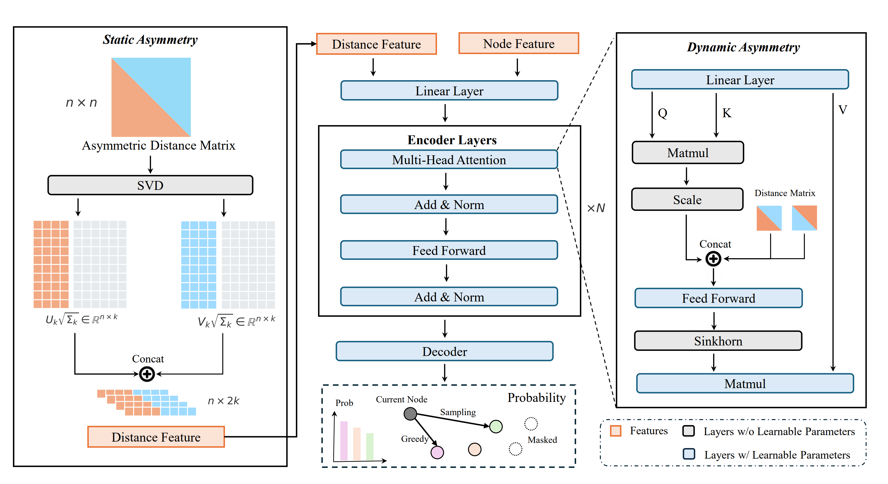

<h1 align="center">RADAR: Learning to Route with Asymmetry-aware Distance Representations</h1>

<p align="center">
  <b>Hang Yi</b>, <b>Ziwei Huang</b>, <b>Yining Ma</b>, <b>Zhiguang Cao</b>
</p>

<p align="center">
  <a href="https://openreview.net/forum?id=lWdxX5s9T1"></a>
  
</p>

---

## Overview

RADAR is a neural combinatorial optimization framework designed for solving asymmetric routing problems, such as the Asymmetric Traveling Salesman Problem (ATSP).

The proposed framework enhances neural routing solvers with the ability to effectively model asymmetric distance matrices. RADAR leverages **Singular Value Decomposition (SVD)** to initialize compact embeddings that capture static asymmetry, and introduces **Sinkhorn normalization** to model dynamic asymmetry during attention interactions.

Extensive experiments on both synthetic and real-world benchmarks demonstrate strong generalization ability and superior performance across various asymmetric VRPs.

<p align="center">
  
</p>

---

## Dataset and Checkpoints

The datasets and pretrained checkpoints used in our experiments can be downloaded from the following links.

| Task | Dataset | Pretrained Model |
|:--|:--:|:--:|
| ATSP | [Google Drive](https://drive.google.com/file/d/1dwKlConq9AhOObcTu-57wOsxr47FEhHU/view?usp=sharing) | [Google Drive](https://drive.google.com/file/d/1vO98NyK3DAaDBAJa5Y6bzWLfyM8QGs_0/view?usp=sharing) |
| ACVRP | [Google Drive](https://drive.google.com/file/d/1OdzFHqj_kvaSgHMRO0l4nvEuyr7RV2fK/view?usp=sharing) | [Google Drive](https://drive.google.com/file/d/10GFNnGh8pKHZbA-YqkhJj3YdaCEIpzic/view?usp=sharing) |

After downloading, unzip each dataset archive into the task folder and each checkpoint archive
into its `result/` folder:

```
RADAR
└── Matnet_radar
    ├── atsp
    │   ├── dataset/ATSP{100,200,500,1000}.npz
    │   └── result/radar_official_checkpoint/checkpoint-2100.pt
    └── acvrp
        ├── dataset/ACVRP{100,200,500,1000}.npz
        └── result/radar_official_checkpoint/checkpoint-2100.pt
```

---

## Training and Testing

Below we provide an example for training and evaluating RADAR on the **ATSP task**; ACVRP works the
same way in `Matnet_radar/acvrp`.

**1. Navigate to the `atsp` directory**

```bash
cd Matnet_radar/atsp
```

**2. Train**

```bash
python train.py
```

**3. Test**

Set `problem_cnt` in `test.py` to the dataset size (`100`, `200`, `500` or `1000`), then run:

```bash
python test.py
```

---

## Real-World Routing (RRNCO Benchmark)

[`RRNCO_radar/`](RRNCO_radar/) applies RADAR to the real-world ATSP, ACVRP and ACVRPTW benchmark
of [RRNCO](https://github.com/ai4co/real-routing-nco), with checkpoints retrained with this code. See
[`RRNCO_radar/README.md`](RRNCO_radar/README.md) for training and testing.

## Multi-Task Asymmetric VRPs (RouteFinder)

[`RouteFinder_radar/`](RouteFinder_radar/) trains RADAR jointly on 16 asymmetric VRP variants (CVRP with open
routes, backhauls, distance limits and time windows) in the [RouteFinder](https://github.com/ai4co/routefinder)
framework, with a checkpoint retrained with this code. See [`RouteFinder_radar/README.md`](RouteFinder_radar/README.md) for
training and testing.

---

## Acknowledgements

This repository is built upon MatNet. We sincerely thank the authors for making their code publicly available, which greatly facilitated the development of this project.

---

## Citation

If you find this work or code useful in your research, please consider citing our paper:

```bibtex
@inproceedings{yi2026radar,
  title={RADAR: Learning to Route with Asymmetry-aware Distance Representations},
  author={Yi, Hang and Huang, Ziwei and Ma, Yining and Cao, Zhiguang},
  booktitle={International Conference on Learning Representations (ICLR)},
  year={2026}
}
```
